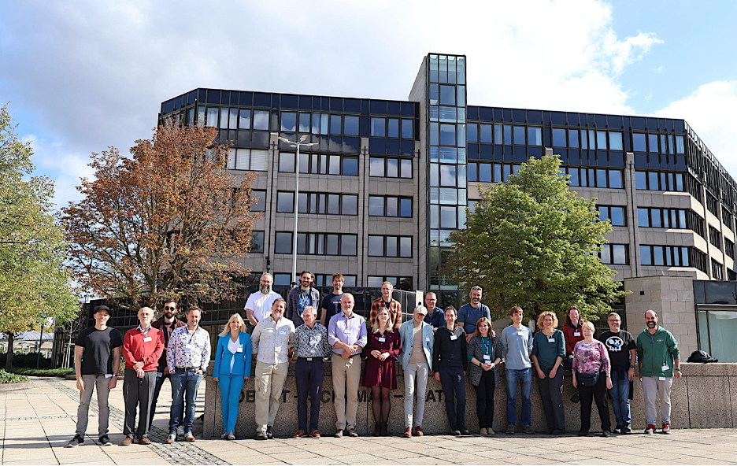

# CF Conventions Community Workshop 2026

The 2026 CF Conventions Community Workshop was held at ECMWF, Bonn, Germany (and online) from Monday 21st to Thursday 24th September 2026.

The workshop was co-hosted by:

- European Centre for Medium-Range Weather Forecasts (ECMWF)
- CF Conventions Community
- Copernicus Climate Change Service (C3S)

## Objectives

The workshop aimed to support collaboration across the CF community, contribute to the evolution and adoption of CF metadata standards, and make practical progress on CF-compliant data and tools.

Themes highlighted for the 2026 workshop included:

- GRIB to CF
- Applying CF to different data formats
- Encoding uncertainty metadata in CF

Additional topics and community suggestions were collected through the programme discussion channels listed below.

## Attendees

A total of 76 confirmed registrations for the workshop, with 24 of these attending on-site.

## Programme and contributions

The programme combined presentations and collaborative sessions. Formats included plenary sessions, keynote and contributed presentations, lightning talks, thematic discussions, parallel breakout sessions, hackathons, and reporting-back sessions.

## Documents

The presentation slides and notes from all the breakout sessions can be found under this google folder and its subfolders: [https://drive.google.com/drive/folders/1rcH2xqOX8Co2Pyj1V_oA-HVxPVQ87Dfq?usp=drive_link](https://drive.google.com/drive/folders/1rcH2xqOX8Co2Pyj1V_oA-HVxPVQ87Dfq?usp=drive_link)

## Agenda

### Day 1 - Monday, 21 September 2026

{: .agenda .table .table-bordered .table-striped}
| Local Time (Bonn)   | Room   | Session  | Presenter/Chair   |
|:-------------|:-------|:-----------------------------------------------------|:----------------------------------------------|
| 13:00 | Main   | **Arrivals and coffee** |   |
| 14:00 | Main   | **Welcome and Overview of meeting structure**  | TBD  |
| 14:10 | Main   | **Introduction to CF** | Jonathan Gregory  |
|       |        | **CF Governance Processes** | Ethan Davis  |
|       |        | **What will be in CF 1.14** | Sadie Bartholomew    |
| 15:00 | Main   | **Coffee break / screen break** |  |
| 15:30 | Main   | **Standard names / Vocabularies** | Alison Pamment   |
| 16:00 | Main | **Introduction to today's breakout sessions** | |
| 16:10 |      | **Breakouts / Hackathons** | |
|       | Room 1 | **CF Profiles, work through with Satellite Swath data** | Ethan Davis |
|       | Room 2 | **Data standards for oil spill models** | Chris Barker |
| 17:30 |        | **Adjourn** |  |
| 18:30 | TBA    | **Workshop dinner** |  |

### Day 2 - Tuesday, 22 September 2026

{: .agenda .table .table-bordered .table-striped}
| Local Time (Bonn)   | Room   | Session  | Presenter/Chair   |
|:-------------|:-------|:-----------------------------------------------------|:----------------------------------------------|
| 09:00 | Main   | **Coffee and welcome** |   |
| 09:30 | Main   | **Uncertainty metadata in CF** | David Hassell, Sam Hunt  |
| 10:00 | Main   | **Units of measure in CF and elsewhere** | Lars Bärring  |
| 10:30 | Main   | **Coffee break / screen break** |  |
| 11:00 | Main   | **Introduction to today's breakout sessions** | |
| 11:10 |        | **Breakouts / Hackathons** | |
|       | Room 1 | **Uncertainty** | David Hassell |
|       | Room 2 | **BCP 14** | Sadie Bartholomew |
| 12:30 |        | **Lunch break and group photograph** |  |
| 14:00 | Main   | **CF and GRIB** | Sébastien Villaume |
| 14:20 | Main   | **CF and Earthkit** | Pawel Wolff |
| 14:40 | Main   | **Implementing CF semantics in BUFR** | Marijana Crepulja |
| 15:00 | Main   | **Coffee break / screen break** |  |
| 15:30 | Main   | **World Meteorological Organization CF-NetCDF profiles and governance** | David I. Berry |
| 16:00 | Main   | **How CF maps to Zarr and relates to GeoZarr** | Max Jones |
| 16:30 | Main   | **Implementing CF semantics in Zarr** | Patrick van Laake |
| 17:00 | Main   | **Discussion of mappings** | |
| 17:30 |        | **Adjourn** |  |

### Day 3 - Wednesday, 23 September 2026

{: .agenda .table .table-bordered .table-striped}
| Local Time (Bonn)   | Room   | Session  | Presenter/Chair   |
|:-------------|:-------|:-----------------------------------------------------|:----------------------------------------------|
| 09:00 | Main   | **Coffee and welcome** |   |
| 09:30 | Main   | **Introduction to today's breakout sessions** | |
| 09:40 |        | **Breakouts / Hackathons** | |
|       | Room 1 | **Housekeeping** | TBA |
|       | Room 2 | **Standard names for chemical species** | Lorea Garcia San Martin |
| 10:30 | Main   | **Coffee break / screen break** |  |
| 11:00 | Main   | **Example C3S uses of CF and netCDF** | Chris Goddard |
| 11:30 | Main   | **Poster and 'unconferencing' slot: Poster viewing and general discussion** | n/a |
| 12:00 | Main   | **CMIP and CORDEX interactions and use of CF Conventions** | Paul Smith (CMIP IPO) |
| 12:30 |        | **Lunch break** |  |
| 14:00 | Main   | **WMO Cloud-optimized future data infrastructure** | Jeremy Tandy |
| 14:30 | Main   | **BADC-CSV adoption by the IPCC community** | Charlotte Pascoe |
| 15:00 | Main   | **Coffee break / screen break** |  |
| 15:30 | Main   | **CF Checkers** | Sadie Bartholomew, Filipe P. A. Fernandes|
| 16:00 | Main   | **Introduction to today's breakout sessions** | |
| 16:10 |        | **Breakouts / Hackathons** | |
|       | Room 1 | **Separating CF semantics from netCDF encoding** | Patrick van Laake |
|       | Room 2 | **Support localization of attribute/variable values** | Erin Turnbull |
| 17:30 |        | **Adjourn** |  |

### Day 4 - Thursday, 24 September 2026

{: .agenda .table .table-bordered .table-striped}
| Local Time (Bonn)   | Room   | Session  | Presenter/Chair   |
|:-------------|:-------|:-----------------------------------------------------|:----------------------------------------------|
| 09:00 | Main   | **Coffee and welcome** |   |
| 09:30 | Main   | **Breakout reports** |  |
| 10:30 | Main   | **Coffee break / screen break** |  |
| 11:00 | Main   | **Wrap-up and Meeting Conclusions** |   |
| 12:30 |        | **Adjourn and Lunch** |  |
